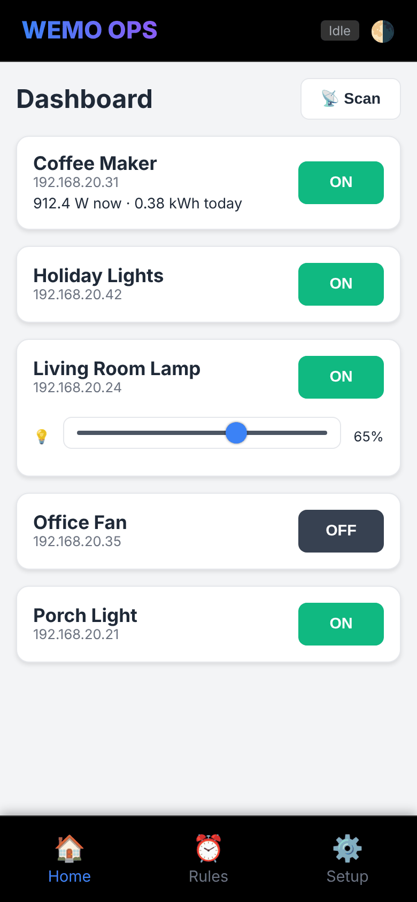
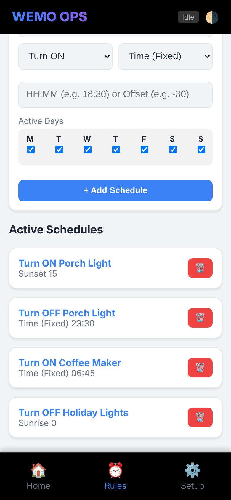
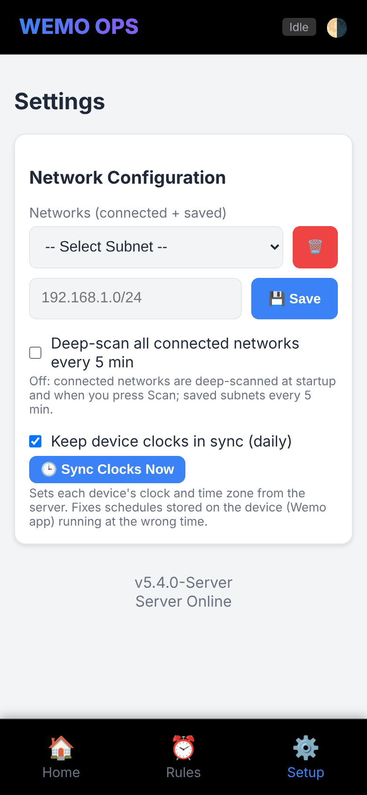

# Mobile Web App

Control your Wemo devices and schedules from a phone, tablet or any browser on your home network. The web app is served by the desktop app's background service or by [Wemo Ops Server](Wemo-Ops-Server.md); there is nothing to install from an app store.

## Open it

* **QR code:** in the desktop app click **Mobile App** in the sidebar and scan the code with your phone's camera.
* **Address:** open `http://<computer-or-server-IP>:5050` in your phone's browser, e.g. `http://192.168.1.10:5050`.

Your phone must be on the same network as the computer or server. If the page doesn't load, see [Troubleshooting](Troubleshooting.md#the-mobile-web-app-wont-open).

## Add it to your home screen

It then opens full screen like an app.

**iPhone and iPad (Safari):**

1. Open the web app in **Safari**.
2. Tap **Share** (the square with an arrow).
3. Tap **Add to Home Screen**, name it "Wemo Ops" and tap **Add**.

**Android (Chrome):**

1. Open the web app in **Chrome**.
2. Tap the **⋮** menu.
3. Tap **Add to Home screen** (or **Install app**) and confirm.

## Pages

<table>
  <tr><th>Home</th><th>Rules</th><th>Setup</th></tr>
  <tr>
    <td></td>
    <td></td>
    <td></td>
  </tr>
</table>

* **Home:** every device with an on/off switch, a brightness slider for Dimmers and power readings for Insight plugs. **📡 Scan** looks for new devices.
* **Rules:** create and delete [schedules run by Wemo Ops](Schedules.md#run-by-wemo-ops) (fixed time or sunrise/sunset, with days). On a server with no schedules yet, the list is just empty.
* **Setup:** networks to scan (add or delete saved subnets), **Deep-scan all connected networks every 5 min**, **Keep device clocks in sync (daily)** and **Sync Clocks Now**.

The web app can't provision new devices, reset devices or manage schedules stored on the plug; use the desktop app for those.

## Away from home

The web app has no login, so don't port-forward port 5050. To use it away from home, connect to your home network with a VPN (for example WireGuard, Tailscale or your router's VPN) and open the same address.
