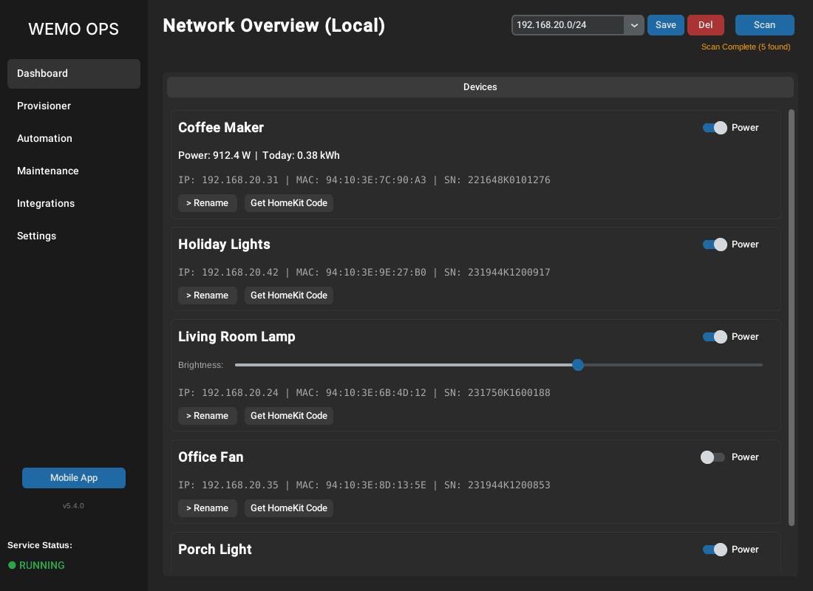
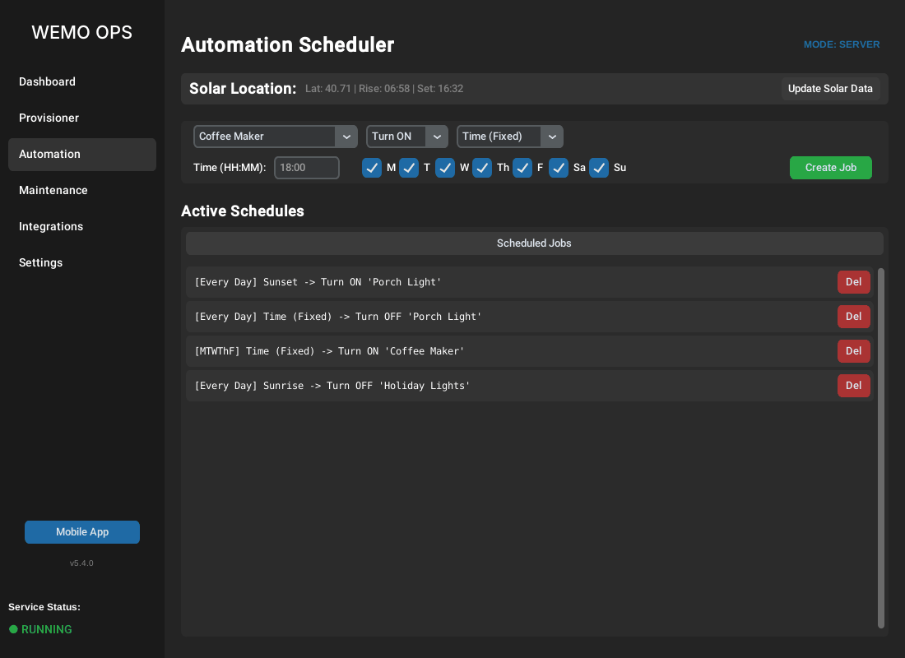

# Desktop App Guide

A tour of each page of the Wemo Ops Center desktop app (v5.6.0). To install it, see [Installation](Installation.md).

_Screenshots use simulated devices._

## Sidebar

* **Dashboard, Provisioner, Automation, Maintenance, Integrations, Settings:** the pages below.
* **Mobile App:** shows a QR code. Scan it with your phone to open the [Mobile Web App](Mobile-Web-App.md).
* **Service Status:** whether the background service is running. Click **▶ Start Service** if it has stopped. With a remote server (see [Settings](#settings)), it shows **CONNECTED** or **UNREACHABLE** instead.
* **Update Available:** appears when a newer stable release is out. It opens the download page.

### The background service

The desktop app comes with a small background service (`wemo_service`, or the `wemo-ops-server` systemd service on Linux). It runs your schedules, keeps device states up to date and serves the mobile web app on port 5050, even when the app window is closed. It starts when you sign in if you kept that option in the installer. Schedules only run while the computer is on and awake; for 24/7 schedules use a [Wemo Ops Server](Wemo-Ops-Server.md).

## Dashboard

Lists every Wemo device found on your networks.

* **Scan:** finds devices. A fast broadcast (SSDP) search shows most devices within seconds, then a deep scan checks every address on your networks for devices broadcast can't reach.
* **Networks:** every network your computer is connected to (for example Ethernet and an IoT Wi-Fi) is scanned. VPN, virtual machine and container adapters are skipped. To scan another subnet or VLAN, type it (e.g. `192.168.20.0/23`) and click **Save**.
* **Each device card** shows its name, IP address, MAC address and serial number, with a power switch.
  * **Dimmers** have a brightness slider (0–100%).
  * **Insight plugs** show current power (W) and today's energy (kWh).
  * **> Rename** changes the name stored on the device.
  * **Get HomeKit Code** shows (and copies) the device's HomeKit setup code, for models that support Apple Home directly.
* Devices with the same name (say three "Wemo Mini") are all listed, with the last 4 characters of the MAC address added.

## Provisioner

Connects a new or reset device to your Wi-Fi. Step by step: [Set Up a New Device](Provisioning.md).

## Automation

Two tabs, one for each place a schedule can run. Full guide: [Schedules](Schedules.md).

* **Run by Wemo Ops** (recommended): fixed-time and sunrise/sunset schedules, run by the background service or your Wemo Ops Server.
* **Stored on Device (experimental):** schedules saved in the plug's own memory.

## Maintenance

Pick the device in the **Device** list at the top; every button acts on that device. Each reset asks you to confirm first.

| Button | What it does | Afterwards |
|---|---|---|
| **Reset Data (1)** | Clears the device's name, icon and rules (schedules stored on it). Keeps Wi-Fi. | Device stays on your network. |
| **Reset Wi-Fi (5)** | Clears the Wi-Fi settings and puts the device back in setup mode. | [Set it up again](Provisioning.md). |
| **Factory Reset (2)** | Erases everything, like a new device. | [Set it up again](Provisioning.md). |
| **Sync Selected Device** / **Sync All Devices** | Sets the device clock and time zone (with daylight saving time) from your computer. | Needed for schedules stored on the device. The device clock can't be read back, so the app can't show it. |

## Integrations

* **Scan & Generate Config:** builds the `BelkinWeMo` platform block for Homebridge/HOOBS `config.json` with the devices found. **Copy Config** copies it.
* **Install Compatibility Layer:** installs Homebridge with its web UI on port 8581 and the `homebridge-wemo` and `homebridge-alexa` plugins, and sets Homebridge up as a service. See [Smart Home Integrations](Integrations.md).

## Settings

* **Appearance Mode:** Light, Dark or System.
* **UI Scaling:** 80% to 200%, for high-resolution screens.
* **Deep-scan all connected networks every 5 min:** off by default. When off, connected networks are deep-scanned at startup and when you click Scan, and saved subnets every 5 minutes.
* **Keep device clocks in sync (daily):** sets every device's clock once a day.
* **Background Service:**
  * **Use the background service on this computer** (default): the app starts and uses its own service.
  * Turn it off to use a **Wemo Ops Server** on another machine: enter its address (e.g. `homelab.local:5050`) and click **Save & Test**. Scans, schedules, settings and the QR code then use that server. See [Wemo Ops Server and Docker](Wemo-Ops-Server.md#connect-the-desktop-app-to-a-server).

## Where your data is

Settings, Wi-Fi profiles, schedules and rules backups are JSON files in the app data folder:

| System | Folder |
|---|---|
| Windows | `%APPDATA%\WemoOps` |
| macOS | `~/Library/Application Support/WemoOps` (the background service uses `~/.local/share/WemoOps`) |
| Linux | `~/.local/share/WemoOps` (the `wemo-ops-server` service uses `/var/lib/wemo-ops`) |

What each file holds: [Wemo Ops Server and Docker](Wemo-Ops-Server.md#data-folders).
